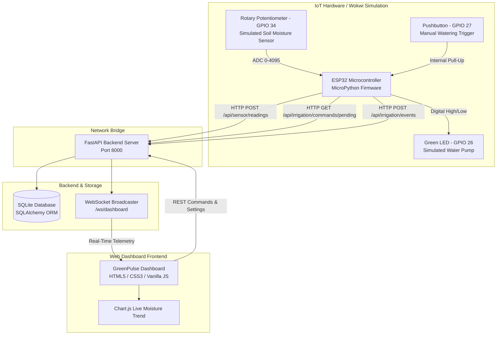

# GreenPulse – Smart Irrigation and Garden Monitoring System Using IoT


**GreenPulse** is an end-to-end IoT Smart Irrigation and Garden Monitoring System designed with ESP32, MicroPython, Wokwi simulation, FastAPI, SQLite, and a responsive web dashboard.

The system continuously samples soil moisture levels, executes automated watering control with hysteresis and safety cutoffs, logs watering events and estimated water volume, alerts users to critical soil moisture drops or device dropouts, and supports on-demand manual irrigation from both hardware pushbuttons and cloud web controls.

---

## 1. System Architecture



---

## 2. Hardware Components & Circuit Wiring

| Hardware Component | Circuit Role | Pin / ESP32 GPIO Assignment | Wiring Specification |
| :--- | :--- | :--- | :--- |
| **ESP32 NodeMCU** | IoT Microcontroller | 3V3, GND, GPIO 34, 26, 27 | Dual-core 240MHz, Wi-Fi 802.11 b/g/n |
| **Potentiometer** | Simulates Soil Moisture Probe | Outer 1 $\to$ **3V3**<br>Middle $\to$ **GPIO 34 (ADC1_CH6)**<br>Outer 2 $\to$ **GND** | 12-bit ADC (0–4095). High ADC = Dry soil, Low ADC = Saturated wet soil. |
| **Green LED** | Represents Irrigation Pump | Anode $\to$ **220Ω Resistor $\to$ GPIO 26**<br>Cathode $\to$ **GND** | Lights up when the irrigation cycle is running. |
| **220Ω Resistor** | Current Limiter | In series with LED anode on **GPIO 26** | Protects LED from overcurrent damage. |
| **Pushbutton** | Manual Watering Push Switch | Terminal 1 $\to$ **GPIO 27**<br>Terminal 2 $\to$ **GND** | Configured via internal pull-up resistor (active LOW). |

---

## 3. Technology Stack

- **IoT Firmware**: MicroPython for ESP32 (`wokwi/main.py`)
- **Circuit Simulation**: Wokwi Circuit Engine (`wokwi/diagram.json`)
- **Backend Framework**: Python 3, FastAPI, Uvicorn (ASGI)
- **Database & ORM**: SQLite (`greenpulse.db`), SQLAlchemy 2.0
- **Real-Time Communication**: WebSockets (`/ws/dashboard`) with Polling Fallback
- **Frontend Dashboard**: Semantic HTML5, Vanilla CSS3 (Nature Green Theme), Vanilla JavaScript (ES6+), Chart.js 4.4

---

## 4. Directory Structure

```
greenpulse/
|-- backend/
|   |-- app/
|   |   |-- __init__.py
|   |   |-- main.py                # FastAPI entrypoint, WebSockets, static mount
|   |   |-- database.py            # SQLite engine & session factory
|   |   |-- models.py              # SQLAlchemy database models
|   |   |-- schemas.py             # Pydantic request/response validators
|   |   |-- services.py            # Retention, alert de-duplication, moisture logic
|   |   |-- websocket_manager.py   # Client broadcast manager
|   |   |-- api/
|   |       |-- devices.py         # Device health, status & heartbeat
|   |       |-- sensors.py         # Sensor reading ingestion & history
|   |       |-- irrigation.py      # Commands, settings, events & CSV export
|   |       |-- dashboard.py       # Aggregated dashboard metrics
|   |       |-- alerts.py          # Alert queries and resolution
|   |       |-- plants.py          # Plant management CRUD
|   |       |-- demo.py            # Demo simulator & test scenario triggers
|   |-- requirements.txt
|   |-- .env.example
|   |-- test_suite.py              # 10-scenario automated test suite
|-- frontend/
|   |-- index.html                 # Responsive dashboard UI
|   |-- css/
|   |   |-- style.css              # Nature-inspired emerald green design system
|   |-- js/
|       |-- api.js                 # Centralized API client
|       |-- charts.js              # Chart.js live moisture trend graphing
|       |-- app.js                 # UI interactions, WebSockets, state controller
|-- wokwi/
|   |-- diagram.json               # Complete Wokwi circuit definition
|   |-- main.py                    # ESP32 MicroPython firmware
|   |-- wokwi.toml                 # Wokwi simulation descriptor
|   |-- README.md                  # Simulation & networking guide
|-- run_server.py                  # Python launcher script
|-- start_windows.bat              # 1-click Windows batch launcher
|-- README.md
```

---

## 5. Step-by-Step Windows Running Instructions

Follow these exact steps in **Windows PowerShell**:

### Step 1: Open Terminal in Project Root
```powershell
cd c:\newww
```

### Step 2: Create and Activate Python Virtual Environment (Optional but Recommended)
```powershell
python -m venv venv
.\venv\Scripts\Activate.ps1
```

### Step 3: Install Dependencies
```powershell
pip install -r backend\requirements.txt
```

### Step 4: Start the FastAPI Backend Server
```powershell
python run_server.py
```
*Alternatively, double-click `start_windows.bat` in Windows Explorer.*

Output in terminal:
```text
==================================================
GreenPulse – Smart Irrigation & Garden Monitoring
Starting FastAPI Backend Server on http://0.0.0.0:8000
Swagger API Docs: http://localhost:8000/docs
Web Dashboard:    http://localhost:8000
==================================================
```

### Step 5: Open the Web Application
Open your web browser and navigate to:
- **Web Dashboard**: [http://localhost:8000](http://localhost:8000)
- **Interactive Swagger API Docs**: [http://localhost:8000/docs](http://localhost:8000/docs)

---

## 6. Running the Wokwi ESP32 Simulation

### Option A: Online at wokwi.com
1. Go to [https://wokwi.com/projects/new/esp32](https://wokwi.com/projects/new/esp32) and choose **MicroPython**.
2. Replace `diagram.json` with the contents of [wokwi/diagram.json](wokwi/diagram.json).
3. Replace `main.py` with the contents of [wokwi/main.py](wokwi/main.py).
4. Click the green **Play** button to run.

### Option B: Local VS Code Wokwi Extension
1. Install the **Wokwi Simulator** extension in VS Code.
2. Open the `wokwi/` directory.
3. Press `F1` $\to$ **Wokwi: Start Simulator**.

### Networking Configuration for Wokwi Simulation
Because Wokwi runs in a browser sandbox, it cannot directly reach `http://localhost:8000` without a network bridge:

1. **Wokwi IoT Gateway (Recommended for local dev)**:
   - Download the Wokwi Gateway tool.
   - In `wokwi/main.py`, point `BACKEND_URL` to `"http://10.0.2.2:8000"` (or your local computer LAN IP).
2. **Public Tunnel (ngrok or localtunnel)**:
   ```powershell
   npx localtunnel --port 8000
   ```
   Set `BACKEND_URL = "https://your-subdomain.loca.lt"` in `wokwi/main.py`.
3. **Web Demo Simulator Mode (Zero-Config Test)**:
   - If running without network tunnels, enable the **"Demo Mode"** toggle in the top-right header of the web dashboard.
   - Use the quick scenario buttons (Scenario 1 through 7) to validate every automated control rule, safety trigger, and chart update directly in the browser.

---

## 7. Functional Testing & Scenario Verification

Run the automated test suite covering all 10 core scenarios:
```powershell
python backend\test_suite.py
```

### Test Scenarios Breakdown:

| Scenario | Conditions | Expected System Response | Test Result |
| :--- | :--- | :--- | :--- |
| **Scenario 1** | Soil moisture is 60% (Optimal) | Pump stays **OFF**; status is marked as Optimal. | **PASSED** |
| **Scenario 2** | Soil moisture drops below 30% | Automatic irrigation triggers pump **ON**; low moisture alert generated. | **PASSED** |
| **Scenario 3** | Moisture rises above 35% (Hysteresis threshold) | Pump turns **OFF** safely to avoid waterlogging. | **PASSED** |
| **Scenario 4** | User clicks "Start Watering" (Manual mode) | Validated command dispatched to backend and queued for device. | **PASSED** |
| **Scenario 5** | User clicks "EMERGENCY STOP" | Pump is deactivated immediately; automatic mode locked; critical alert logged. | **PASSED** |
| **Scenario 6** | Device stops transmitting for > 30s | System flags device as **OFFLINE**; displays timestamp of last known reading. | **PASSED** |
| **Scenario 7** | Sensor returns out-of-range ADC (> 4095) | Reading rejected (HTTP 422); pump forced into safe **OFF** state. | **PASSED** |
| **Scenario 8** | User refreshes dashboard page | All telemetry, charts, plant lists, and history hydrated from SQLite database. | **PASSED** |
| **Scenario 9** | User clicks "Download CSV" | Formatted CSV file downloaded with timestamps, modes, moisture deltas, and water volume. | **PASSED** |
| **Scenario 10** | Backend health check | Endpoint `/api/health` returns status 200 OK and version metadata. | **PASSED** |

---

## 8. Calibration & Moisture Calculation Formula

The potentiometer simulates an analog soil probe using ESP32 ADC on GPIO 34:

$$\text{Moisture Percentage} = \left( \frac{\text{adc\_value} - \text{dry\_adc}}{\text{wet\_adc} - \text{dry\_adc}} \right) \times 100$$

- **Default Dry Calibration**: `4095` (0% Moisture, high resistance / dry soil)
- **Default Wet Calibration**: `1500` (100% Moisture, high conductivity / saturated soil)
- Both values can be adjusted live from the **Settings** tab.

### Soil Classification Ranges:
- **0% – 29% (Dry)**: Below irrigation threshold. Automatic watering triggers if enabled.
- **30% – 44% (Acceptable)**: Soil moisture is adequate but declining.
- **45% – 75% (Comfortable)**: Optimal demonstration plant root moisture zone.
- **76% – 100% (High)**: Saturated soil. Check plant root drainage.

---

## 9. Troubleshooting & FAQ

**Q: The dashboard shows "Device offline – displaying the last available reading." Why?**  
A: A device is marked offline if no telemetry or heartbeat has been received within 30 seconds. Verify the ESP32 is running and sending POST requests to `/api/sensor/readings`. If testing locally without the ESP32 running, enable **Demo Mode** in the header to simulate readings.

**Q: Can I run this without installing Python packages globally?**  
A: Yes, use a Python virtual environment (`python -m venv venv`) as explained in Section 5.

**Q: How is water consumption calculated?**  
A: The circuit has no physical flow sensor. Water volume is calculated from pump run duration using standard micro-drip pump flow rates (~0.02 Liters/sec or ~1.2 Liters/min).

---

## 10. License

This project is licensed under the MIT License. Developed for IoT coursework and practical embedded systems demonstrations.
